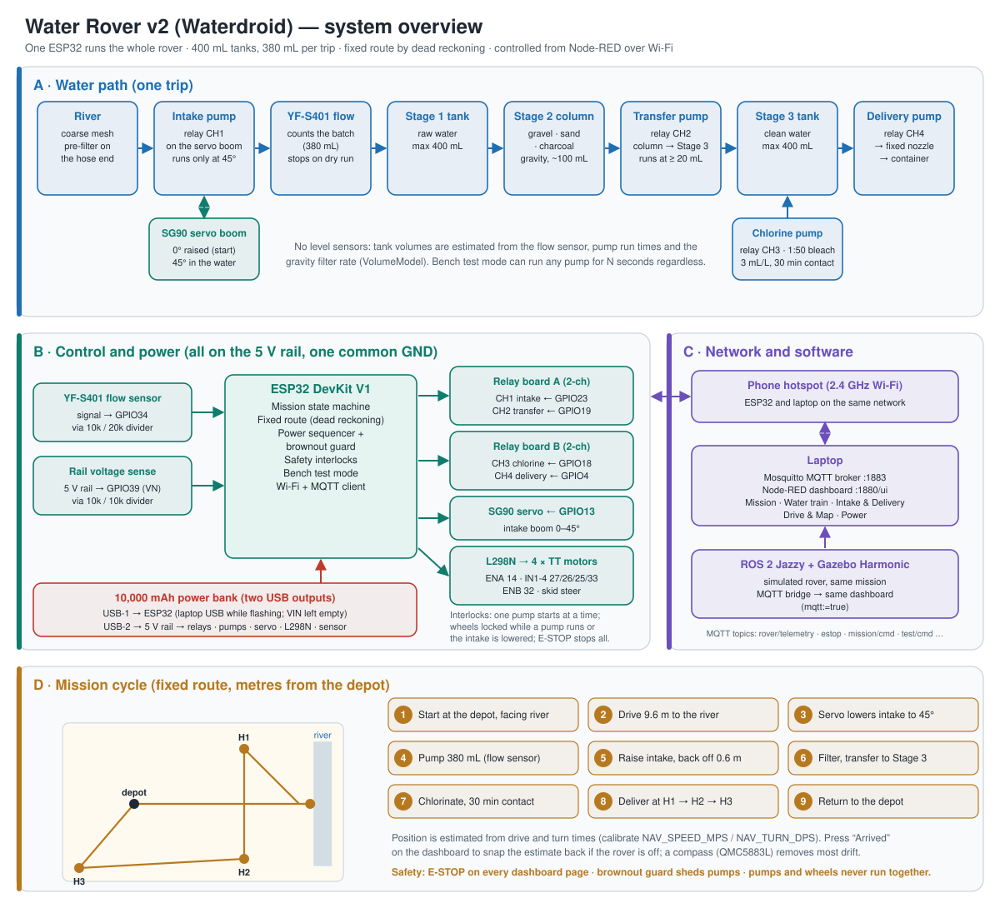
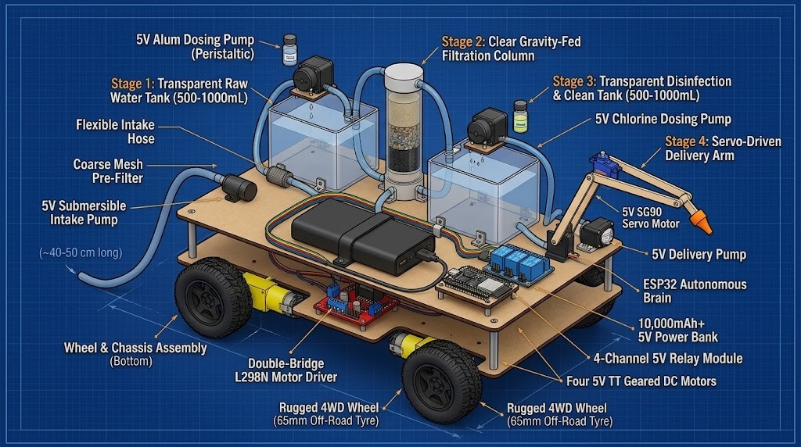

# Water Rover v2 (Waterdroid) — autonomous river-to-homestead water treatment rover

A 4WD rover that drives to a river, pumps raw water through a coarse pre-filter into Stage 1,
gravity-filters it through the Stage 2 column, pumps it into the Stage 3 delivery tank, chlorinates it, then drives to each homestead
and dispenses clean water through a fixed nozzle. An SG90 servo lowers the intake into the river and raises it before driving.



<details><summary>Original design drawing</summary>



</details>

| Folder | What | Start here |
|--------|------|-----------|
| `src/` | ROS 2 Jazzy + Gazebo Harmonic simulation (4 packages) | `ros2 launch waterdroid_bringup simulation.launch.py` |
| `firmware/waterdroid_esp32/` | **integrated ESP32 firmware** — every subsystem on the one board | `docs/HARDWARE.md` for wiring |
| `firmware/tests/` | host unit tests for all firmware logic | `bash firmware/tests/run_tests.sh` |
| `xod/waterdroid/` | XOD C++ nodes for issues #1 #3 #5 #6 #8 #9 #11 #12 (generated from the firmware cores) | open in XOD IDE |
| `power-management/` | issue #10 power sequencer (ESP32 sketch, XOD node, Node-RED flow, tests) | its own README / tests |
| `node-red/` | central SCADA dashboard (#12), builders and validator | import `node-red/waterdroid_dashboard.json` |
| `*.json`, `*.ino` (root) | team members' subsystem flows and bench-test sketches | see `docs/ISSUES.md` |
| `webots/` | earlier Webots prototype | — |
| `docs/` | `system_overview.svg` (this diagram, built by `diagrams/build_overview.py`), `HARDWARE.md` (parts, pin map, wiring), `TOPICS.md` (MQTT + ROS topics), `FLASHING.md`, `ISSUES.md`, `wiring/` (wiring diagrams) | open `docs/wiring/*.svg` |

## Simulation (Ubuntu 24.04, ROS 2 Jazzy, Gazebo Harmonic)

```bash
sudo apt install ros-jazzy-ros-gz ros-jazzy-xacro ros-jazzy-robot-state-publisher \
                 ros-jazzy-joint-state-publisher-gui python3-paho-mqtt
mkdir -p ~/water_ws && cd ~/water_ws
git clone https://github.com/n02531614p/water-rover-v2-simulation.git src/water-rover-v2-simulation
colcon build --symlink-install && source install/setup.bash

ros2 launch waterdroid_bringup simulation.launch.py              # full mission, perfect position
ros2 launch waterdroid_bringup simulation.launch.py mission:=route   # fixed route by dead reckoning, like the real rover
ros2 launch waterdroid_bringup simulation.launch.py mqtt:=true   # + drive the Node-RED dashboard
ros2 launch waterdroid_bringup simulation.launch.py mission:=none rviz:=true
ros2 launch waterdroid_bringup simulation.launch.py gui:=false            # headless (no GPU / over SSH)
ros2 launch waterdroid_description display.launch.py             # model only, with joint sliders
```

The `gt` mission (default) runs the whole cycle on `v2_village.sdf`: drive to the river → servo lowers the
intake → pump the batch → intake raised → filtration + transfer pump → chlorine + contact time → reverse, pivot → three
homesteads (deliver through the fixed nozzle) → depot.
Watch it with `ros2 topic echo /waterdroid/status`. Pause / resume / abort / E-stop:

```bash
ros2 topic pub --once /waterdroid/mission/cmd std_msgs/String "data: pause"
ros2 topic pub --once /waterdroid/estop std_msgs/Bool "data: true"
```

## Real rover

1. Wire it as in `docs/HARDWARE.md` (one pin map for everything).
2. Arduino IDE: step-by-step in `docs/FLASHING.md` (ESP32 board package, PubSubClient, ESP32Servo).
3. Set Wi-Fi + broker IP at the top of `firmware/waterdroid_esp32/waterdroid_esp32.ino`, calibrate, flash.
4. Run Mosquitto + Node-RED (with `node-red-dashboard`), import `node-red/waterdroid_dashboard.json`.
5. Measure your route into `DEFAULT_ROUTE` and calibrate (docs/HARDWARE.md). Dashboard → Mission → **Start mission**; press **Arrived: river / homestead** at a
   stop only if the estimate drifts — the rover follows the fixed route on its own. **EMERGENCY STOP** is on every page.
6. Bench test any pump for a set time over MQTT: publish `intake 10`, `transfer 5`, `chlorine 3` or `delivery 5`
   (seconds, max 30) to `rover/test/cmd`, or type `test intake 10` in the Serial Monitor. E-STOP and the
   interlocks still apply.

## Checks

```bash
bash firmware/tests/run_tests.sh            # 393 unit checks + sketch compile checks
bash power-management/power-management/tests/run_tests.sh
python3 xod/waterdroid/check_xod.py         # XOD nodes compile
python3 node-red/validate_flows.py          # all flows: ids, wires, groups, JS syntax
```
